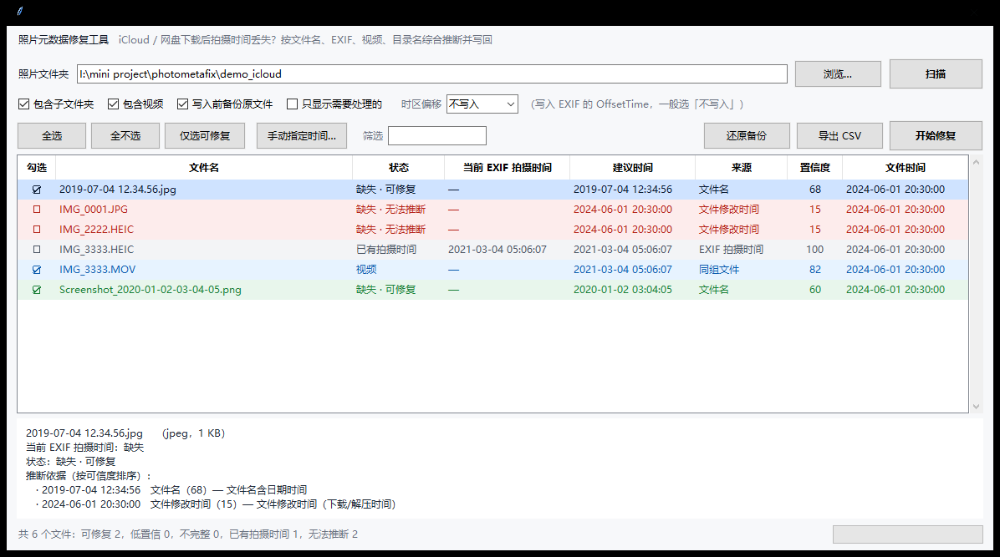

# 照片元数据修复工具（PhotoMetaFix）

专治**「从 iCloud 网页端下载 ZIP、解压之后照片的拍摄时间全没了」**这个问题：
照片的 EXIF 被剥离，文件修改时间被改成下载时刻，于是相册里一律显示成「2024-06-01 下载」。

这个工具会扫描整个文件夹，**从所有还能用的线索里把拍摄时间挖出来**，列出每张照片的判断依据和可信度，
让你先看一遍，再一键写回 EXIF 拍摄时间和文件时间。原文件会先备份，随时可以还原。

- 纯 Python 标准库，**不需要安装任何依赖**
- Windows 双击即用（Python 3.9+，自带 tkinter 即可）
- 支持 JPEG / HEIC / PNG / TIFF 的 EXIF 写入，MOV / MP4 只调整文件时间
- 写入前有预览、有置信度、有备份、可还原、可导出 CSV 报告



---

## 一、快速开始

1. 把 `photometafix` 整个文件夹放在任意位置（不用安装）。
2. 双击 **`启动工具.bat`**（如果系统没关联 Python，就用 `pythonw app.pyw` 打开）。
3. 选择照片文件夹 → 点「扫描」。
4. 看「状态 / 建议时间 / 来源 / 置信度」几列，绿色 = 有把握，黄色 = 低置信，红色 = 推断不出来。
5. 点「开始修复」，确认后即可写回。

> 想先试试手感？用 `demo_icloud` 文件夹，里面是模拟 iCloud 下载后的样本（时间被剥离、
> 修改时间统一成下载时间）。修复完可以用「还原备份」恢复原样。

命令行也支持指定目录直接打开：

```bat
pythonw app.pyw "D:\照片\iCloud 下载"
```

---

## 二、它从哪里推断时间

按可信度从高到低依次尝试，每一行都会在界面「详情」区展示出来：

| 来源 | 可信度 | 说明 |
|---|---|---|
| EXIF `DateTimeOriginal` | 100 | 相机/手机记录的原始拍摄时间（正常情况） |
| EXIF `DateTimeDigitized` | 92 | 数字化时间，通常等于拍摄时间 |
| XMP `DateTimeOriginal` / `CreateDate` | 84–88 | Adobe 系软件写的 XMP |
| 同名 Live Photo 视频 | 82 | `IMG_1234.HEIC` + `IMG_1234.MOV` 互相对齐 |
| IPTC `DateCreated` | 78 | 新闻/图库工作流常用 |
| 文件内嵌视频日期 `©day` | 80 | MOV 里的拍摄日期 |
| EXIF GPS 时间 | 70 | GPS 是 UTC，会标注来源 |
| 文件名 | 42–68 | `2019-07-04 12.34.56.jpg`、`IMG_20230704_123456`、`PXL_...`、`Screenshot_...`、`微信图片_20190704123456` 等 |
| EXIF `DateTime`(IFD0) | 55 | 可能是修图后保存时间，仅供参考 |
| 目录名 | 20–28 | 相册常按「2021-08」命名 |
| 文件修改时间 | 15 | **最不靠谱 —— 通常就是下载时间** |

判定规则：

- 已经有 `DateTimeOriginal` 的：标记「已有拍摄时间」，默认不勾选（不会乱改）。
- 只有 `DateTimeDigitized` / `DateTime` 的：标记「不完整」，会补齐 `DateTimeOriginal`。
- 什么都没有：按上表取最高分。≥60 记「可修复」，30–59 记「低置信」，<30 记「无法推断」。
- 「无法推断」的默认不勾选 —— 工具**不会瞎猜**。你可以选中它，双击手动指定一个时间。

---

## 三、写回什么

对每张选中的照片：

1. **EXIF**：`DateTimeOriginal`、`DateTimeDigitized`，必要时补 `DateTime`、`Software`；
   勾了「时区偏移」还会写 `OffsetTimeOriginal` / `OffsetTimeDigitized`。
2. **文件时间**：修改时间、访问时间改成拍摄时间（Windows 的「创建时间」系统接口不开放，不改）。
3. **校验**：写完重新读一遍，对不上就报告失败。

各格式的写入方式（都不搬动原有像素数据）：

| 格式 | 做法 |
|---|---|
| JPEG | 替换/插入 APP1 段（`Exif\0\0`），图像数据原样接在后面 |
| HEIC | 改写 Exif item：新数据放得下就原地覆盖，放不下就追加到文件末尾并改 `iloc` 指向，`mdat` 完全不动 |
| PNG | 在 IHDR 之后插入/替换 `eXIf` 块，重算 CRC |
| TIFF | 直接重写 TIFF 结构 |
| MOV / MP4 | 只改文件时间，不动容器（避免破坏视频） |

---

## 四、备份与还原

- 勾选「写入前备份原文件」（默认开）时，原文件会原样复制到
  **`<照片文件夹>\.pmfix_backup\<相对路径>`**，只备份一次。
- 界面上的「还原备份」会用备份覆盖当前文件，恢复成修复前的样子。
- 确认没问题后，可以手动删掉 `.pmfix_backup` 文件夹。

---

## 五、界面说明

```
[照片文件夹] ............ [浏览…] [扫描]
☑包含子文件夹 ☑包含视频 ☑写入前备份 ☑只显示需要处理的   时区偏移 [不写入]
[全选][全不选][仅选可修复][手动指定时间…]  筛选[____]      [还原备份][导出CSV][开始修复]
┌──────────────────────────────────────────────────────────┐
│勾选│文件名│状态│当前EXIF拍摄时间│建议时间│来源│置信度│文件时间│
└──────────────────────────────────────────────────────────┘
选中一行查看该文件的全部时间线索……
```

- **第一列 ☑/☐ 直接点一下就能切换**；空格键也能切换；`Ctrl`/`Shift` 多选。
- **双击一行** = 手动指定时间（格式 `YYYY-MM-DD HH:MM:SS`），会以 100 的置信度覆盖自动判断。
- 点表头可以排序。
- 「导出 CSV」生成 UTF-8 BOM 的报告，Excel 直接打开不乱码，含每个文件的判断依据与结果。

---

## 六、常见问题

**Q：为什么有些照片标「无法推断」？**
说明文件里 EXIF 被彻底剥掉，文件名也不含日期（iCloud 下载的常见形态就是 `IMG_0001.JPG`），
同组的 Live Photo 视频也没有日期。这种情况下任何工具都无法凭内容还原真实拍摄时间 ——
本工具选择如实标出来，而不是给一个假时间。你可以手动指定，或直接跳过。

**Q：会不会把原本正确的照片改坏？**
不会。已有 `DateTimeOriginal` 的默认不勾选；修复前有备份；写完全量校验；失败会列出来。
另外写入采用「临时文件 + 原子替换」，中途失败不会留下半个坏文件。

**Q：HEIC 改写安全吗？**
安全。新 Exif 放不下时是**追加到文件末尾**再改 `iloc` 里的偏移/长度，
原有 `mdat`（图像数据）一个字节都不移动；第二次改同样的文件就变成原地覆盖，文件不再变长。

**Q：为什么时区默认「不写入」？**
EXIF 的拍摄时间本来就是「相机本地时间」，不带时区。除非你要跨时区整理素材，
否则写 `OffsetTime` 反而可能让部分软件换算后显示错位。

**Q：会有信息损失吗？**
当原文件 EXIF 里带着厂商私有 `MakerNote`，且需要重建 EXIF 结构时（原文件缺时间标签），
`MakerNote` 的字节会完整保留，但它内部若存有绝对偏移，个别厂商私有字段可能读不出来。
时间、GPS、缩略图、相机型号这些标准字段不会丢（有自测覆盖）。

**Q：视频为什么只改文件时间？**
重排 MOV/MP4 容器风险高、收益低；Live Photo 的时间已经通过照片写回，视频只需要在文件管理器里排序正确。

---

## 七、开发

```
photometafix/
├── app.pyw                 双击入口（带 DPI 适配与崩溃提示）
├── 启动工具.bat
├── pmfix/
│   ├── exif.py             TIFF/EXIF 解析与序列化（大端/小端、就地修补）
│   ├── jpeg.py             JPEG APPn 段拆分与重组
│   ├── heif.py             HEIC Exif item 读写（就地 / 追加）
│   ├── png.py / mp4.py / boxes.py
│   ├── xmp.py / iptc.py    额外元数据来源
│   ├── dates.py            文件名 / 目录名 / 文件系统时间推断
│   ├── reader.py           统一读取入口 + 原子写入
│   ├── scanner.py          扫描、候选排序、置信度、状态机
│   ├── repair.py           备份、写回、校验、还原
│   ├── report.py           CSV / JSON 报告
│   └── ui.py               Tkinter 界面
├── tests/
│   ├── fixtures.py         构造最小合法 JPEG/HEIC/PNG/MOV
│   ├── selftest.py         核心引擎 + 端到端（61 项）
│   └── ui_smoke.py         界面冒烟（15 项）
└── demo_icloud/            模拟 iCloud 下载后的样本
```

运行测试：

```bat
python tests\selftest.py
python tests\ui_smoke.py
```

作为库使用：

```python
from datetime import datetime
from pmfix import jpeg, exif

data = open("IMG_0001.jpg", "rb").read()
new = jpeg.write_tiff(data, exif.new_tiff(datetime(2019, 7, 4, 12, 34, 56)).to_bytes())
open("IMG_0001_fixed.jpg", "wb").write(new)
```

---

## 八、已知限制

- 不处理 XMP 边车的写入，也不写 IPTC（只读取作为依据）。
- HEIC 若使用多 extent 存储 Exif，或根本没有 Exif item，会跳过并提示（不冒险改结构）。
- 极小概率遇到构造异常的 JPEG（中间夹带裸 0xFF 的 APP 段）会被判为损坏并跳过。
- 「创建时间」无法修改，这是 Windows 的限制。

---

测试状态：核心引擎 61 项、界面冒烟 15 项，全部通过。
